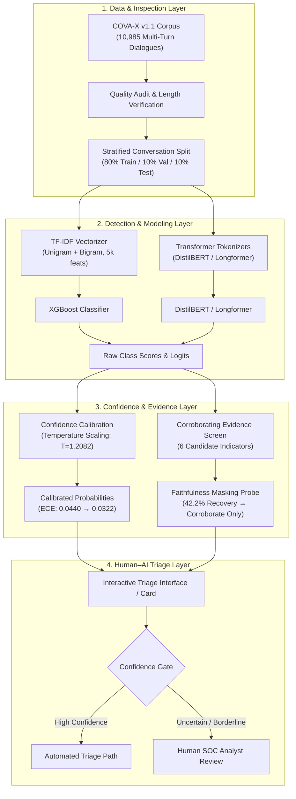
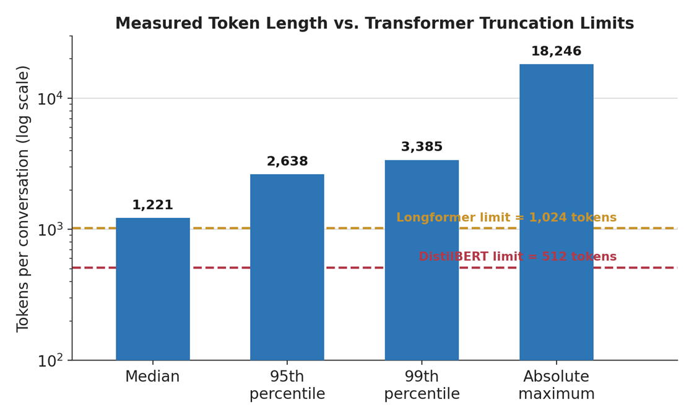
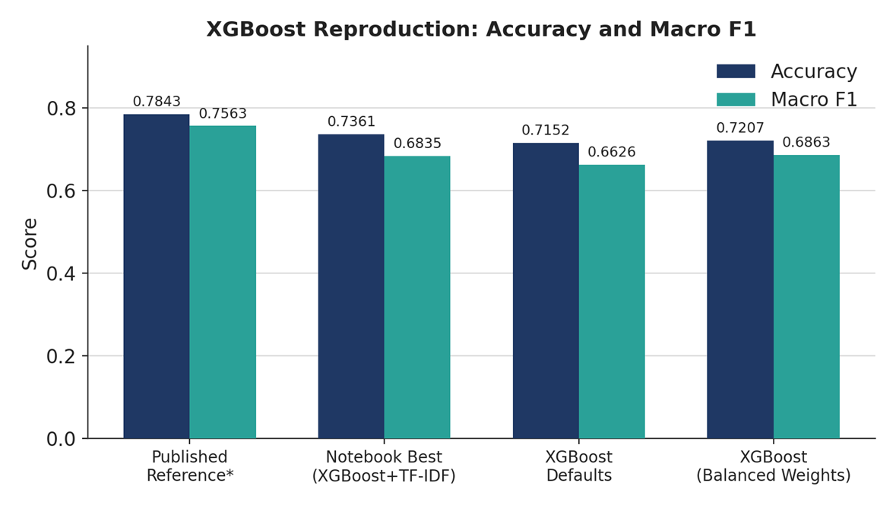
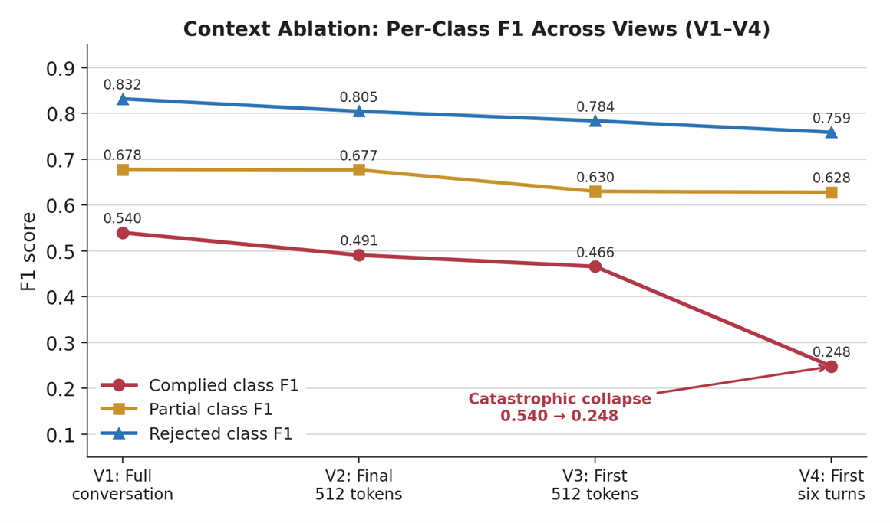
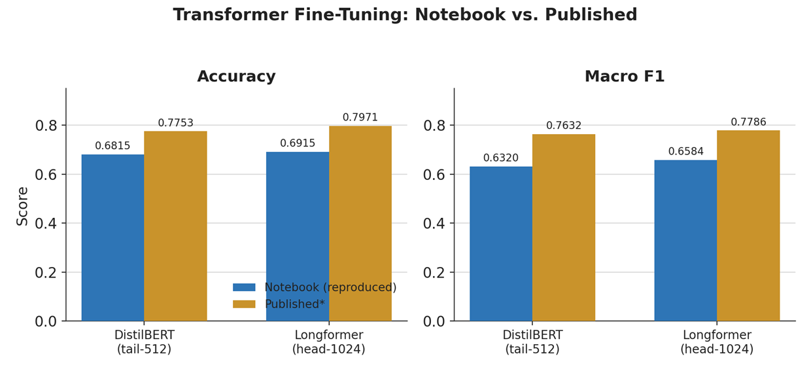
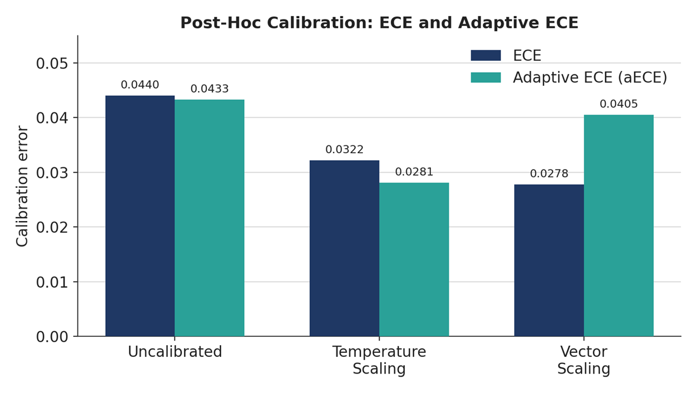
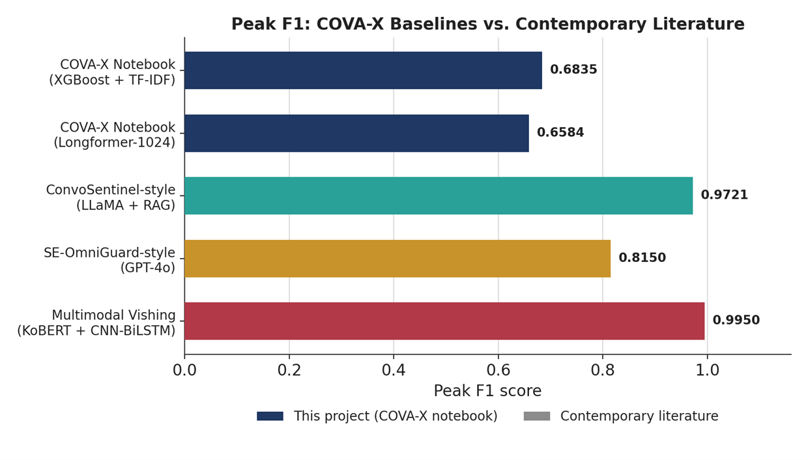

# Human–AI Collaborative Triage in Conversational Social Engineering Detection

<p align="center">
  
</p>

<p align="center">
  <strong>Advanced Computational Evaluation of Multi-Turn Conversational Social Engineering Detection Systems</strong><br>
  Department of Electrical and Computer Engineering &bull; North South University &bull; Summer 2026
</p>

<p align="center">
  <a href="https://github.com/nawmee02/Human-AI-Conversational-Social-Engineering-Triage"></a>
  <a href="LICENSE"></a>
  <a href="https://pytorch.org/"></a>
  <a href="https://huggingface.co/"></a>
  <a href="https://xgboost.readthedocs.io/"></a>
  <a href="docs/Human_AI_Collaborative_Triage_Thesis_Report.pdf"></a>
</p>

---

## 📌 Executive Overview

Modern social engineering attacks—such as "pig butchering" investment frauds, voice phishing (vishing), and relationship-building impersonation schemes—unfold slowly over multi-turn dialogues. Attackers establish rapport and emotional dependency before introducing malicious requests, bypassing traditional single-message spam/phishing filters.

This repository provides the official implementation, empirical reproduction code, audit tools, and decision-support triage architecture for our undergraduate directed research thesis at **North South University**:

1. **Empirical Reproduction & Audit:** Systematic replication of published baselines on the **COVA-X corpus (10,985 multi-turn conversations)** (*Lochstampfor & Roy, 2026*), uncovering critical token length and floor-filter discrepancies.
2. **Temporal Context Ablation:** Demonstration that high conversational classification accuracy is driven by late-turn victim compliance cues, exposing the limitations of full-transcript classifiers for early-warning detection.
3. **Post-Hoc Confidence Calibration:** Implementing Temperature Scaling ($T=1.2082$) and Vector Scaling to correct model overconfidence without compromising classification decision boundaries.
4. **Explanation Faithfulness Testing:** Rigorous masking validation revealing that lexical indicators are **corroborating evidence**, not faithful explanations of model reasoning.
5. **Human–AI Collaborative Triage Architecture:** A 4-layer triage workflow with a 4-arm experimental design that controls for scam-type base rates to prevent automation bias in SOC environments.

---

## 🏗️ System Architecture

The proposed triage system separates raw detection from decision-support to safeguard against alert fatigue and automation bias in Security Operations Centers (SOCs):



---

## 🔍 Key Findings & Empirical Results

### 1. Corpus Audit: The Token Length Reality

Published benchmarks reported a maximum conversation length of **874 tokens**, claiming 512-token models truncate only $\sim 20\%$ of conversations. An empirical audit using the `distilbert-base-uncased` tokenizer reveals that conversations are an order of magnitude longer:

<p align="center">
  
</p>

* **Measured Median Length:** 1,221 tokens
* **95th Percentile:** 2,638 tokens | **99th Percentile:** 3,385 tokens
* **Maximum Observed:** 18,246 tokens
* **True Truncation Rate:** **94.5%** of conversations are truncated by DistilBERT-512, and **61.9%** are truncated by Longformer-1024.

---

### 2. Baseline Reproduction & The Feature Gap

We reproduced the classical XGBoost and transformer baselines on the 3-class target: **Complied** (*successful_scam*), **Partial** (*partial_compliance*), and **Rejected** (*scam_detected, quick_rejection, verification_attempt*):

<p align="center">
  
</p>

| Model Configuration | Accuracy | Macro F1 | Weighted F1 | F1 (Complied / Partial / Rejected) |
| :--- | :---: | :---: | :---: | :---: |
| **Published Reference (28 Undisclosed Features)** | **0.7843** | **0.7563** | **0.7825** | 0.677 / 0.728 / 0.864 |
| **Notebook Best (XGBoost + TF-IDF)** | **0.7361** | **0.6835** | **0.7280** | 0.540 / 0.678 / 0.832 |
| XGBoost Defaults | 0.7152 | 0.6626 | 0.7086 | 0.514 / 0.659 / 0.815 |
| XGBoost with Balanced Weights | 0.7207 | 0.6863 | 0.7170 | 0.597 / 0.639 / 0.823 |

> **Critical Discovery:** The $-4.8\%$ accuracy / $-0.073$ macro-F1 reproduction gap is concentrated in the **Complied** class (identifying 77 vs 108 cases). The **Rejected** class reproduces to within a few samples (451 vs 446). The 28 undisclosed engineered features in the original paper were heavily tied to compliance cues.

---

### 3. Context Ablation: The Early Triage Problem

To determine whether the classifier can detect scams *before* damage occurs, we evaluated four conversation views while keeping labels, splits, and parameters identical:

<p align="center">
  
</p>

| Context View | Accuracy | Macro F1 | F1 Complied | F1 Partial | F1 Rejected |
| :--- | :---: | :---: | :---: | :---: | :---: |
| **$V_1$: Full conversation** | **0.7361** | **0.6835** | **0.540** | 0.678 | 0.832 |
| **$V_2$: Final 512 tokens** | 0.7161 | 0.6575 | 0.491 | 0.677 | 0.805 |
| **$V_3$: First 512 tokens** | 0.6833 | 0.6268 | 0.466 | 0.630 | 0.784 |
| **$V_4$: First 6 turns (Early Horizon)** | 0.6515 | 0.5447 | **0.248** ⚠️ | 0.628 | 0.759 |

* Restricting context to the first 6 turns triggers a **catastrophic collapse in Complied F1 from 0.540 to 0.248**.
* Full-context models operate as **retrospective classifiers**—they detect that a scam succeeded only after the victim complied. They cannot serve as real-time early intervention systems without sequential turn-level modeling.

---

### 4. Transformer Baselines & Context Constraints

<p align="center">
  
</p>

| Architecture | Notebook Acc | Notebook Macro F1 | Published Acc | Published Macro F1 |
| :--- | :---: | :---: | :---: | :---: |
| **DistilBERT (tail-512)** | 0.6815 | 0.6320 | 0.7753 | 0.7632 |
| **Longformer (head-1024)** | 0.6915 | 0.6584 | 0.7971 | 0.7786 |

Longformer edges out DistilBERT, matching the published directional trend, but neither model has full access to context because 61.9% of dialogues exceed 1,024 tokens.

---

### 5. Confidence Calibration & Reliability

Uncalibrated tree ensembles produce overconfident probabilities ($T = 1.2082$). We evaluate post-hoc temperature and vector scaling:

<p align="center">
  
</p>

| Calibration Method | ECE &darr; | aECE &darr; | MCE &darr; | NLL &darr; | Brier &darr; | Accuracy |
| :--- | :---: | :---: | :---: | :---: | :---: | :---: |
| **Uncalibrated** | 0.0440 | 0.0433 | 0.6090 | 0.6037 | 0.3615 | **0.7361** |
| **Temperature Scaling** | **0.0322** | **0.0281** | 0.2356 | 0.5990 | 0.3587 | **0.7361** |
| **Vector Scaling** | 0.0278 | 0.0405 | **0.1238** | **0.5963** | **0.3581** | 0.7325 |

* **Temperature Scaling** reduces Expected Calibration Error (ECE) from 0.0440 to 0.0322 while leaving the underlying decision boundary and accuracy completely untouched.
* It is adopted as the conservative, safe configuration for triage support.

---

### 6. Evidence Faithfulness Testing

Candidate indicators were screened for correlation with harm:

| Candidate Indicator | Detection Channel | Association / Coverage | Screening Decision |
| :--- | :---: | :---: | :--- |
| **One-time password (OTP) request** | Attacker | Coverage: 3.1% | Excluded (insufficient coverage) |
| **Password / credential request** | Attacker | Coverage: 1.4% | Excluded (insufficient coverage) |
| **Banking information request** | Attacker | Coverage: 30.7% | **Retained** as corroborating cue |
| **Suspicious URL** | Attacker | Low association | Excluded |
| **Urgency language** | Attacker | Weak discrimination | Excluded |
| **Financial request** | Attacker | Strong correlation | **Retained** as corroborating cue |

* When masked and evaluated against the classifier, the retained cues recovered **42.2% above-chance discrimination** (below the pre-registered 50% validity threshold).
* **Ethical AI Stance:** They are surfaced strictly as **corroborating evidence**, not as "model reasoning explanations", ensuring analysts do not over-trust highlighted snippets.

---

### 7. Comparative Benchmark Against Literature

<p align="center">
  
</p>

| Model or Framework | Primary Detection Approach | Peak Accuracy | Peak Macro F1 |
| :--- | :--- | :---: | :---: |
| **COVA-X Notebook (Ours)** | **Static lexical retrospective (TF-IDF + XGBoost)** | **0.7361** | **0.6835** |
| **COVA-X Notebook (Ours)** | **Truncated contextual encoding (Longformer-1024)** | **0.6915** | **0.6584** |
| ConvoSentinel-style | Retrieval-augmented generation & conversation analysis | 0.9800 | 0.9721 |
| SE-OmniGuard-style | Dynamic psychological state tracking | 0.8130 | 0.8150 |
| Multimodal Vishing Defence | Text and audio fusion | N/A | 0.9950 |

---

## 📂 Repository Structure

```plaintext
Human-AI-Conversational-Social-Engineering-Triage/
├── assets/
│   ├── nsu_logo.png
│   ├── token_length_distribution.png
│   ├── xgboost_reproduction_comparison.png
│   ├── context_ablation_collapse.png
│   ├── transformer_finetuning_gap.png
│   ├── confidence_calibration_ece.png
│   └── literature_benchmark_comparison.png
├── docs/
│   └── Human_AI_Collaborative_Triage_Thesis_Report.pdf  # Complete 48-page thesis report
├── notebooks/
│   └── cova_x_evaluation_and_triage.ipynb               # 54-cell reproducible Kaggle pipeline
├── .gitignore
├── LICENSE                                              # MIT License
├── requirements.txt
└── README.md
```

---

## 🚀 Quickstart & Reproduction

### Prerequisites
* Python 3.9+ with CUDA support
* GPU recommendation: 1x or 2x NVIDIA Tesla T4 (or equivalent with $\ge 16$ GB VRAM)

### 1. Clone the Repository
```bash
git clone https://github.com/nawmee02/Human-AI-Conversational-Social-Engineering-Triage.git
cd Human-AI-Conversational-Social-Engineering-Triage
```

### 2. Environment Setup
```bash
python -m venv .venv
# On Windows:
.venv\Scripts\activate
# On Linux/macOS:
source .venv/bin/activate

pip install --upgrade pip
pip install -r requirements.txt
```

### 3. Running the Jupyter Notebook
You can run the notebook locally or on Kaggle/Google Colab:
```bash
jupyter lab notebooks/cova_x_evaluation_and_triage.ipynb
```

> **Kaggle Execution Note:** If running on Kaggle, upload `COVA-X_Dataset.zip` into your Kaggle inputs and enable **GPU T4 x 2** accelerator in the notebook settings.

---

## 👥 Authors & Academic Affiliation

### Project Team
* **Sharmin Akter Badhon** (ID: 2211413042)
* **Arman Hossain Nawmee** (ID: 2221395042) &bull; [GitHub](https://github.com/nawmee02)
* **Md. Nakibul Islam Khan** (ID: 2212770042)
* **Md. Rizuan Al Masud Raeen** (ID: 2212398642)

### Faculty Advisor
* **Dr. Shafin Rahman**  
  Associate Professor, Department of Electrical and Computer Engineering  
  **North South University**, Dhaka, Bangladesh

---

## 📜 Citation

If you reference this work or build upon the methodology, please cite:

```bibtex
@thesis{badhon2026humanai,
  title     = {Human--AI Collaborative Triage in Conversational Social Engineering Detection},
  author    = {Badhon, Sharmin Akter and Nawmee, Arman Hossain and Khan, Md. Nakibul Islam and Raeen, Md. Rizuan Al Masud},
  school    = {North South University},
  department= {Department of Electrical and Computer Engineering},
  year      = {2026},
  note      = {Supervised by Dr. Shafin Rahman}
}
```
